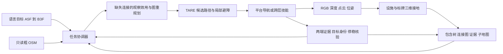

# 粗地理先验下的跨楼宇、跨楼层目标导航：研究与系统方案

状态：2026-09-27 的原始设计稿；部署进度以本项目 README 为准。本轮新增的 P1 诊断基线已在 Isaac 中完成跨楼宇跨楼层路线，详见 `p1-results.md`；该基线使用二维码和理想里程计，不等于下文提出的研究方法，也没有机器狗实测。TARE_WheelTECH 的 `codex/cross-building-floor-nav` 分支从本机 `main` 的 `c991d73` 建立。用户提到的 Navsys 是另一个 TARE＋VLM 机器狗导航项目，作为架构和基线参考；TARE_WheelTECH 独立的 `unitree` 分支已有 Go2 适配记录，可作为后续载具接口来源。研究任务与载具集成分别演进。

## 0. 一句话判断与贡献边界

任务是 **Cross-Building and Cross-Floor Goal Navigation with Coarse Geographic Priors**。输入“从 A 楼 5F 去 B 楼 3F 公共区域”，机器人只知道粗 OSM 的建筑身份、轮廓和可走的室外路网，以及起点建筑/楼层；室内出入口、垂直交通和连廊需要在线观察。OSM 在这个任务里提供目标建筑的身份和跨建筑道路级关系；如果移去它，机器人无法在首次进入未见过的园区时确定哪一栋是 B，除非另给等价的地理先验。论文必须通过无 OSM/错误 OSM/不同完整度 OSM 的实验，检验这种“必要性”，而不是只在系统图中画一个 OSM 模块。

可争取的研究贡献应收敛到两项：**带证据状态的在线连接发现与可修正的层级规划**，以及 **在缺失连接时，选择最有价值的可达观察位姿**。分楼层地图、VLM、TARE、DINO、楼梯识别与 Go2 执行本身已有先例，不能单独作为核心新意。若没有跨楼宇跨楼层的连续可执行数据与强基线，这更像工程系统论文，尚不足以断言达到 CVPR 水平。

## 1. 任务协议：先固定可重复的评测条件

| 项目 | 第 1 版固定定义 | 不允许偷给方法的信息 |
| --- | --- | --- |
| 指令 | `A / 5F -> B / 3F / public_region`，可扩展到大厅或房门 | 不以物体实例作为终点 |
| 先验 | 相同版本的只读 OSM：建筑 ID/名称/轮廓、室外人行连通图；起点建筑与楼层 | 室内平面图、入口精确坐标、楼梯/电梯位置、连廊及每个连接的可用性 |
| 在线观测 | 同步 RGB、深度/点云、内参/外参、里程计和局部可行走地图；VLM/OCR 只看可见内容 | 仿真语义标签、全局真值位姿、隐藏完整连接图不能进入策略 |
| 动作 | 地面移动、到观察位姿、验证、由能力接口支持的楼层转移 | 若没有电梯操作或爬楼技能，不伪称机器人能自主使用 |
| 成功 | 本体停在 B 楼 3F 的指定可达公共区域，且建筑/楼层身份由独立证据确认；电梯轿厢内不算 | “发出了前往 3F 的动作”或“看见 3F 标牌”不算成功 |
| 失败与预算 | 碰撞、跌落、禁区、超时、无法确认、错误楼层/建筑、传感器或定位失效分别记码 | 不把超时后的接管计作方法成功 |

第 1 版可明确选择 **电梯作为跨层技能**，把电梯呼叫/按键做成经显式标注的仿真交互 API；视觉必须发现、接近并验证电梯，API 只负责门、轿厢和楼层变化。若电梯技能暂不可得，先做能自主爬楼的楼梯场景，但 Go2 当前适配尚未验证爬楼。两种能力不应混在同一成绩里。任何人工帮忙按电梯都须记为 `human_assisted` 单独报告。不可达目标应允许 `UNREACHABLE`，同时报告误判与过早放弃率。

## 2. A5F → B3F 的完整闭环

初始内存 `M=(H,G_conn,{L_i},E)`：`H` 是园区/建筑/楼层/区域的**包含树**；`G_conn` 是带方向、能力条件、证据和状态的**可通行连接图**；`L_i` 是相互分离的局部三维子地图；`E` 是带时间、位姿和传感器来源的图像、文字、几何与实际穿越记录。OSM 只读；在线更新的是机器人自己的经历。跨层或定位重置后另建地图坐标纪元，先重定位再沿边行动。

| 步骤 | 系统的实际决策与动作 | 进入下一步的可验证条件 |
| --- | --- | --- |
| 0 解析 | 把语言归一为目标建筑 `B`、目标楼层 `3F`、终点区域、预算和禁止条件。OSM 用建筑 ID 解析 B；保存 A5F 起点假设及来源。 | 目标建筑唯一且可定位；歧义时停下请求澄清。 |
| 1 找离开 A5F 的连接 | VLM 解释“电梯→”一类方向证据；三维模块把门洞/楼梯口/电梯厅/可读标牌落到可达观察位姿。任务效用选择观察路线，TARE 提供可行路径。 | 发现设施后还要确认是否可用、去哪一层。若看到连接 A5F→B 楼的连廊，立即重新规划。 |
| 2 转移至离开 A 楼的区域 | 执行被支持的楼层转移技能；记录起点、动作、时序与终点观测。入口和出口为两个不同地点。 | 终点楼层经实际转移、楼层字样、几何/视觉一致性确认；未确认就继续观察，不擅自标记已到某层。 |
| 3 找建筑出口 | 从当前楼层探索真正通向室外的可达出口，必要时尝试多个候选；门牌与出口箭头只产生线索。 | 穿越后观测和定位表明已进入室外可通行空间。 |
| 4 楼间移动 | 把 A 的已验证出口锚到 OSM 人行图，沿路到 B 的**可接近边界/入口候选**；动态障碍由局部规划处理，不能朝建筑质心穿墙。 | B 建筑身份由 OSM 匹配和可见建筑/地址证据确认；入口实际可进入。 |
| 5 找 B3F 连接 | 进入 B 后新建/切换 B 楼子地图，识别楼层与可用电梯/楼梯；优先利用已验证的目标层边，未知时继续定向观察。 | 有满足能力与方向条件的连接；穿越完成并产生终点证据。 |
| 6 验证并停稳 | 用建筑身份、楼层标牌、转移历史和局部结构共同验证在 B3F 公共区域；检查非轿厢、可达、定位健康。 | 运动停止及最终语义条件同时成立才返回 `SUCCEEDED`。 |

高层不是硬编码六步脚本。每轮以 `H+G_conn` 重新选择路线；新连廊、关闭的门、无法使用的电梯都能改变路径。连接状态至少是 `CANDIDATE`（看见设施）、`INDICATED`（观察到去向线索）、`TRAVERSED`（穿越成功）、`VERIFIED`（终点身份已确认）、`BLOCKED/STALE`；只有 `VERIFIED` 的有向边可作为已知路线复用。`INDICATED` 边可以引导观察或尝试，必须计入风险；标牌所在地和箭头指向地是不同几何实体。

一次失败例子：在 A5F 看到“电梯→”，到达电梯厅后面板显示只服务 4F–8F。系统保留“电梯厅存在”和面板证据，但不创建 A5F→出口层的真实边；把这个候选降权，寻找楼梯或另一组电梯。若楼梯口有能力限制，该边对当前载具不可用。只对**当前可执行的连接路径**估价，而不是对朝 B 的欧氏距离估价。

### 2.1 候选选择与安全边界

对可达观察位姿 `v`，定义任务效用 `U(v)=w_1*预期连接信息增益 + w_2*路线价值 + w_3*可见文字质量 - w_4*行驶时间 - w_5*风险 - w_6*重复观察`。这只是可比较分数；未校准前不要称概率。连接路线则优化预期到达成本、能力约束和失败恢复成本，可用分层图上的滚动重规划或 belief-aware search。VLM 只选**空间子目标及验证问题**；深度/点云、标定、TF、时间戳与局部碰撞检查共同把候选变成几何目标。TARE 的目标是找/确认连接、沿已知路径、去观察位姿、执行转移技能四种任务态，不由 VLM 生成速度或穿墙 waypoint。

## 3. 模块契约与本仓库如何接入

| 模块 | 输入 → 输出 | 首轮实现顺序 |
| --- | --- | --- |
| 任务协调器 | 指令、预算、能力 → 任务 ID/修订、当前待确认空间转换、停止条件 | 先做纯离线状态机与回放 |
| OSM 适配器 | OSM 截取、建筑别名、人行路网 → 建筑候选与室外路线 | 固定地图版本和可见标签白名单 |
| 视觉与三维接地 | RGB + 深度/点云 + 标定/TF → 设施、标牌方向、可达观察位姿、证据引用 | 先让 GT/人工标注作为诊断上限，再替换为真实检测；不可把 GT 喂给正式方法 |
| 连接记忆 | 设施/标牌/穿越/重定位事件 → 有向边、状态、证据、置信和地图纪元 | 稳定 ID、跨视角关联、终点核验 |
| 任务探索与路径 | 当前缺失连接、局部地图、能力 → 候选优先级和可执行目标 | 在 TARE 外先做调度；需要的上游改动保存为补丁并单独审计 |
| 转移技能 | 接近位姿、目标层、授权 → 成功/失败/两端证据 | 仿真电梯 API 或经验证的楼梯技能；第一版禁止假设 Go2 会按键/爬楼 |
| 平台适配 | 统一目标/反馈/急停 → Go2 或 C50C 的受控执行 | Go2 走 `unitree` 分支独立适配，实车仅在单独授权后验证 |

本机 `main` 的现有实链是 MID360→ARISE→terrain/TARE→localPlanner→pathFollower→C50C。`unitree` 分支已有 Go2 速度出口与 SysNav 源码/架构文档，但其 VLM/任务接口仍标记为**设计、未实现**；Go2 楼梯、电梯和整链真实导航没有验收。避免把 `vendor/sysnav` 的整套 ROS Jazzy 栈直接覆盖当前 Humble 系统。优先抽象 `NavigateToPose / Observe / TraverseConnector / Stop / Health` 能力层；后续若要合并 `unitree`，单独评审所需提交与依赖，不改 `config/robot.yaml` 或实车运行状态来完成论文设计。

现有 `sim2real/` 是另一个 Git 仓库，官方 Unity Player 只有可运行二进制和补丁，没有可编辑 Scene/Prefab；它的单场景 TARE 自主探索闭环也尚未通过验收。因此不能直接声称它支持 A5F→B3F。新多楼宇场景与数据应放在**独立仿真仓库/分支**，遵守其文件边界；本研究分支只保存协议、评测设计和将来可移植的任务层。正式选择引擎前先验证可编辑场景、传感器、门/电梯交互和机器人动力学。

## 4. 如何与其他方法公平比较

不能把跨楼宇跨层总成功率直接与只做单楼层或 ObjectNav 的论文表格相减。统一环境、观测、OSM 白名单、预算、机器人能力和终点判据；复现实验的适配代码公开并标明新增部分。

| 组别 | 比较方法/改造 | 主要回答的问题 |
| --- | --- | --- |
| 内部最小基线 | 同一底盘、SLAM、TARE/局部规划，普通前沿探索 + “向目标建筑靠近”启发式 | 不建连接图会怎样？ |
| OSM 消融基线 | 同一模型和感知，移除 OSM；或只给目标建筑质心；或给错误/不完整道路 | 粗地理先验究竟带来多少、对错误先验多敏感？ |
| 连接图基线 | OSM + 普通前沿，已看见的门/电梯用简单规则；无证据分级或重规划 | 证据状态和动态重新规划是否有效？ |
| OPEN 扩展 | 使用 OPEN/OpenBench 的 OSM→已知位置→未知入口搜索思想，增加统一的室内跨层策略 | 入口发现与整体任务耦合的收益；明确是**本研究适配版**。 |
| ASCENT/MFNP 扩展 | 在相同环境中接入其跨层探索策略，并额外提供同一 OSM 室外模块 | 在线跨层策略的对比；ObjectNav 原始分数不能直接拿来比。 |
| HOV-SG / osmAG | 提供完整预建室内层级图，作为**更强先验上限** | 有完整图时的效率上限；不列为同等信息条件。 |
| NavVerse 适配 | 若拿到可扩展场景/代码，在相同多层跨楼宇任务上移植模块化或 VLA 基线 | 连续执行与跨环境基线；原版主要是室内→室外。 |

对每个方法记 `SR`（最终成功）、`SPL`/路径效率、总时间、室内/室外/楼层转移各阶段成功率、连接发现召回/精确率、错误边采纳率、误停率、碰撞/跌落/急停次数、VLM 调用数与推理时延。SPL 的最短路分母必须在**完整真实连接图和同一载具能力**上求，并标明其只用于离线评价。报告按“是否允许连廊、目标楼层差、入口是否已知、目标不可达、OSM 错误程度”分层；随机种子配对、按**建筑/园区**划分训练/验证/测试，给置信区间，不以同一楼的换起点当跨场景泛化。

## 5. 仿真接入与数据清单

**路线选择**：研究主实验优先一个能编辑场景和交互的物理引擎。Isaac Sim 官方提供 ROS 2 Bridge、RGB-D/LiDAR、URDF/OpenUSD 导入；NavVerse 也基于 Isaac Sim，因此可作为场景/评测接口参考，但原版多数场景为单层，且未评估室外→室内，必须新增多楼宇、垂直交通和回入建筑。若团队拿到可编辑的现有 Unity 工程，也可沿 Unity/ROS-TCP 方案继续；当前 `sim2real` 的 Player 不能承担新场景建模。Habitat/MP3D/HM3D 可先做跨层策略预训练/诊断，但不替代连续、可交互的最终任务验收。

**分三级建场景，避免一开始把所有风险堆在一起**：P0 为连接图与文字/视觉证据的可重复离线回放，检验状态机、错误证据和连廊重规划；P1 为 A 楼至少五层、B 楼至少三层、室外路网、至少两种垂直连接、多个入口和一条可选连廊的可编辑三维场景，用统一基座完成真正连续动作；P2 扩充到多个独立建筑群、不同布局/外观/标牌语言/OSM 缺失度、动态门与不可达任务，测试泛化和安全。P0 的图 oracle 只用于单元诊断；P1/P2 方法不能读取隐藏连接真值。

每个场景至少有以下**两份隔离的数据**：公开给方法的 `prior.osm` 快照、建筑别名表和传感器/能力配置；只给评测器的真实包含关系、双向/单向连接、入口、可用条件、楼层身份、目标区域和最短可执行路径。将 OSM 里精确入口、室内楼层/走廊/电梯标记按预先固定规则剔除；保存原始快照、过滤代码和过滤后文件哈希。若真实 OSM 没有 B 的可靠名称/轮廓，应单独标为 `prior_missing`，不能私下用 GT 补齐。

采集/构建清单：建筑 A/B/C 的可编辑几何与碰撞体；楼层高度、门宽、楼梯坡度/台阶、电梯门和轿厢逻辑；人行路网与可进入边界；可见标牌/门牌及其准确朝向；机器人几何和能力（能否爬楼、上台阶、乘电梯、按键）；RGB-D/LiDAR/IMU 参数、内外参、噪声与时间同步；跨室内外定位漂移与重定位诊断；合法通行区域和碰撞类别；任务与失败标签；渲染/运动时钟。最终数据还需许可、脱敏、版本、划分和生成种子。

场景与策略之间固定 `reset(seed, scene, start, goal, prior_version)`、`observe()`、`act(navigation_goal or skill)`、`terminate()`；评测器记录每帧原始观测、动作、连接状态变化、地图版本、VLM 输出、碰撞与最终停稳。用独立记录复算指标，避免策略自己宣布成功。ROS 接入需对齐 `/clock`、TF、相机/LiDAR 时间、SLAM 坐标纪元及仿真域；沿用现有 `sim2real` 的域 88 仅在其独立环境内，新增仿真必须先核对域/端口占用。

## 6. 面向 CVPR 的证据与消融矩阵

这是建议的论文证据门槛，**不是 CVPR 官方最低数量或录用保证**。

1. **主结果**：在完全未见过的建筑群上，完整 A5F→B3F 类任务取得比同先验、同动作能力的强基线更高的成功率，且效率与安全代价清楚；至少覆盖含连廊、无连廊、未知入口和错误标牌四类场景。
2. **真正的 OSM 作用**：同一个模型比较无 OSM、只给建筑 ID/质心、粗 OSM、错误/缺路的 OSM、完整室内图 oracle 上限。解释为什么收益出现在楼间目标定位/道路选择，而不是因额外语义标签泄漏。
3. **核心方法消融**：去证据分级、去有向/能力条件、去跨视角关联、固定阶段脚本不重规划、任务效用换几何前沿、去标牌方向、去终点多证据验证；一次只改一项，保持其他模块和计算预算相同。
4. **感知与系统诊断**：连接候选检测、3D 接地、同一连接重识别、OCR/箭头方向、楼层身份确认的独立误差；分别测 GT 感知上限和真实感知，说明瓶颈。VLM/API 预算、延时、显存与失败恢复次数都记录。
5. **泛化/鲁棒性**：按建筑群隔离训练测试；OSM 错误、标牌遮挡/相似楼层、入口关闭、定位漂移、传感器噪声、动态行人等受控扰动。每组报告样本量、配对种子与区间；若只做单场景演示，不能写“泛化”。
6. **实体结果**：在机器狗及其能力接口可用后，先完成无底盘/仿真/实体能力的逐级验收，再做少量授权的真实跨区域试验。楼梯和电梯需分别写“自主、API 辅助、人工辅助”；物理演示不能替代大规模仿真统计，也不能用仿真结果冒充实机。

论文主表建议列 `SR ↑ / SPL ↑ / 时间 ↓ / 转移成功率 ↑ / 碰撞率 ↓ / 误停率 ↓`；附图包括问题设置与信息遮挡、A5F→B3F 成功/失败轨迹、连接图逐步更新、反直觉“先向西去电梯”案例、错 OSM/错标牌曲线、跨场景失败分解。预注册主要指标与终止规则，保存失败样例，避免只展示可运行视频。

## 7. 论文逐节逐段写作蓝图（有结果后再写结论句）

| Section / 段 | 该段要回答的具体问题与证据 |
| --- | --- |
| Abstract 1 | 一句话任务与挑战：跨楼宇/楼层，粗 OSM 可见而室内连接未知。 |
| Abstract 2 | 一句话方法：带证据的有向连接记忆、任务相关观察位姿、在线重规划。 |
| Abstract 3 | 一句话评测：新场景/协议、同信息基线和主要数字；没有结果前留占位符。 |
| 1 Introduction ¶1 | 从校园配送/引导的真实 A5F→B3F 例子引出目标是空间身份，不是物体。图 1 标出“先向西去电梯”。 |
| 1 Introduction ¶2 | 定义输入可见/不可见，说明 OSM 必要性和室内连接未知的核心困难。 |
| 1 Introduction ¶3 | 分析现有工作覆盖缺口：已知室内图、未知多楼层 ObjNav、室内外过渡各解决部分问题；用表而非空泛 SOTA 论断。 |
| 1 Introduction ¶4 | 概述连接证据状态、可修正规划、观察价值的因果链；指出旧楼层/电梯知识何时可复用。 |
| 1 Introduction ¶5 | 只列实际完成的贡献：方法、可复现实验、最关键发现；若数据未发布或实体未测，不能写进贡献。 |
| 2 Related Work ¶1 | 已知层级地图：osmAG/osmAG-Nav、HOV-SG 的先验种类、任务和局限。 |
| 2 Related Work ¶2 | 在线多层：MFNP、ASCENT 的楼层探索和 ObjectNav；明确“目标物体”与“指定空间”区别。 |
| 2 Related Work ¶3 | 粗地理先验与跨环境：OPEN、NavVerse、SignLoc；说清各自的地图/入口/方向性标牌条件。 |
| 3 Problem Setup ¶1 | 状态、观测、先验、隐藏真值、动作及载具能力；明确 OSM 过滤规则。 |
| 3 Problem Setup ¶2 | 目标与终止：正确建筑、楼层、公共区域、停稳、不可达与误停。 |
| 3 Problem Setup ¶3 | 评测 oracle 与方法输入隔离、训练/测试按建筑群分割，比较时的公平预算。 |
| 4 Method ¶1 | 系统总览和接口：语言/OSM→空间目标→连接图→局部导航→转移→验证。 |
| 4 Method ¶2 | 空间包含树与有向连接图的数据结构、身份/地图纪元。 |
| 4 Method ¶3 | RGB-D/点云/DINO/VLM/OCR 怎样生成设施、标牌方向和三维观察位姿，并表达不确定性。 |
| 4 Method ¶4 | 候选→指示→穿越→验证状态转移、两端证据与错误修正规则。 |
| 4 Method ¶5 | 缺失连接的观察位姿效用、能力约束和路线价值；给算法框与复杂度。 |
| 4 Method ¶6 | 在线图重规划、连廊/堵门例子；TARE 或其他局部规划器的明确职责。 |
| 4 Method ¶7 | 最终身份验证、停止、失败恢复和执行权限边界。 |
| 5 Benchmark / Implementation ¶1 | 场景来源、几何、OSM 快照/过滤与标牌、电梯交互实现。 |
| 5 Benchmark / Implementation ¶2 | 机器人/传感器/仿真/ROS 接口与训练数据；GT 仅作离线 oracle。 |
| 5 Benchmark / Implementation ¶3 | 任务采样、能力分组、不可达任务、数据划分和质量检查。 |
| 5 Benchmark / Implementation ¶4 | 主要指标、失败标签、配对种子/区间、基线适配与资源预算。 |
| 6 Experiments ¶1 | 总任务表，指出何种场景有效、何种场景无效，避免只报平均 SR。 |
| 6 Experiments ¶2 | OSM 信息量/噪声实验，验证任务里的地理先验需求。 |
| 6 Experiments ¶3 | 连接记忆/证据/重规划消融及错误边分析。 |
| 6 Experiments ¶4 | 感知与观察位姿模块消融，连接检测和 OCR 误差如何传到终点。 |
| 6 Experiments ¶5 | 安全、延时、预算和 OOD 泛化；报告区间与样本数。 |
| 6 Experiments ¶6 | 有授权且完成时才写 Go2 实体试验；分清独立技能或人工协助。 |
| 7 Limitations ¶1 | OSM 覆盖和地理配准误差、无障碍设施可用性、未支持的门禁/电梯交互。 |
| 7 Limitations ¶2 | 仿真到真实的视觉/动力学差距与研究伦理/通行权限。 |
| 8 Conclusion ¶1 | 只复述由主表和消融支持的发现，以及明确的下一步。 |

附录应放完整任务/数据协议、图状态机、能力/动作说明、所有基线适配细节、超参数、统计方法、每场景失败分析、许可和复现步骤。写作时每段用“主张→对应图表/实验→边界”，避免在实验前预填优胜数字。

## 8. 需要用户准备的材料与开始顺序

**现在就能开始**：本设计、离线任务协议、连接图 schema 和纯回放验证不依赖实物，也不需要额外 Navsys 源码。本仓库 `unitree` 分支已有 SysNav 来源和 Go2 接入记录，可供参考。要进入真实连续仿真，最小阻塞项是 **一份可编辑的多楼宇多楼层场景来源** 或同意从零建 P1 场景，以及可运行的仿真/GPU 环境。将来确定实机载具时，需给出 **机器狗型号、传感器安装/外参和已经验证的运动/楼梯/电梯能力**；如果用户说的 Navsys 与现有 `unitree` 分支所审计的 SysNav 不是同一个项目，届时再提供确切仓库即可。要形成 CVPR 级实验，还需 **合法可用的 OSM/建筑场景数据、独立建筑群测试划分、标牌和连接真值标注、场景编辑与评测人力、计算预算**。实体试验另需现场通行/电梯权限、急停和逐轮授权。

建议实施关卡：

| 关卡 | 交付物 | 通过才进入下一关的条件 |
| --- | --- | --- |
| G0 任务冻结 | 上述输入/输出、先验白名单、能力分组、指标和数据格式 | A5F→B3F 空间区域终点/电梯辅助条件无歧义 |
| G1 图与证据 | 独立模块、回放器、连廊/误标牌/单向入口案例 | 不从“看见”直接跳到“已验证”；错误连接可撤回 |
| G2 可编辑仿真 | P1 场景、隐藏 oracle、传感器和评测器 | 同一场景内能完成楼内→室外→楼内→楼上闭环，且无 GT 泄漏 |
| G3 方法 | 视觉接地、观察效用、重规划、TARE/导航接口 | 多种场景任务成功、安全与失效均可自动复算 |
| G4 论文评测 | 强基线、消融、独立场景群、统计与失败分析 | 贡献由实验支撑；再决定是否投 CVPR |
| G5 实体 | 独立 Go2 能力、无底盘、仿真、授权现场闭环证据 | 分别记录，不能合并为单一“验收通过” |

## 原始来源（核对日 2026-09-27）

- [NavVerse 论文](https://arxiv.org/html/2607.19695v1)：Isaac Sim 连续室内→室外基准；限制段明确多数为单层、未做室外→室内。
- [OPEN / OpenBench 论文](https://arxiv.org/html/2502.09238v1)：OSM 驱动室外末端配送及未知入口搜索。
- [osmAG-Nav 论文](https://arxiv.org/abs/2603.28271)：依赖已构建层级 topometric 图，其实体跨楼层验证不能等同未知连接任务。
- [HOV-SG 论文](https://arxiv.org/abs/2403.17846)：预构建的楼层/房间/物体场景图。
- [MFNP 论文](https://arxiv.org/abs/2409.10906)、[ASCENT 论文](https://arxiv.org/abs/2505.23019)：在线跨层 ObjectNav 的对照。
- [SignLoc 论文](https://arxiv.org/abs/2508.18606)：标牌方向与公共地图的定位，论文地图包括楼层图和 OSM 图。
- [Isaac Sim 官方 ROS 2 文档](https://docs.isaacsim.omniverse.nvidia.com/latest/ros2_tutorials/overview/ros2_reference_architecture.html)：ROS 2 Bridge、传感器和场景导入能力。
- [OpenStreetMap 建筑映射说明](https://wiki.openstreetmap.org/wiki/Building)：入口可单独标注，因此本任务必须固定过滤规则与是否允许入口先验。
