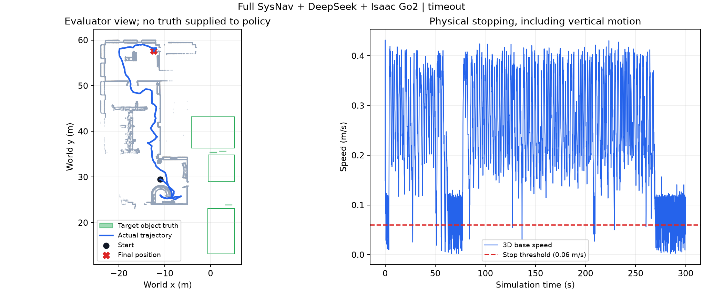
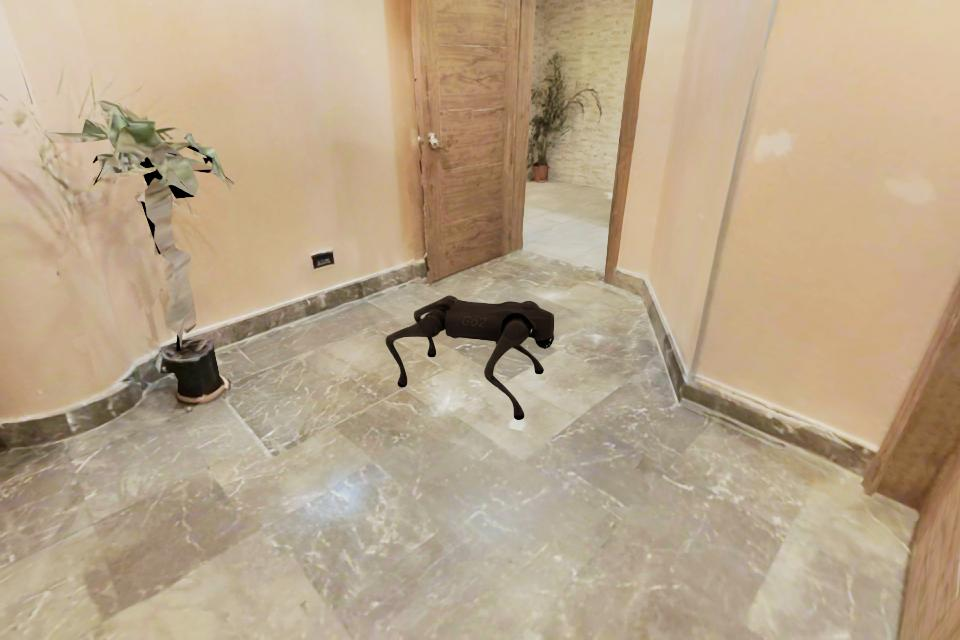
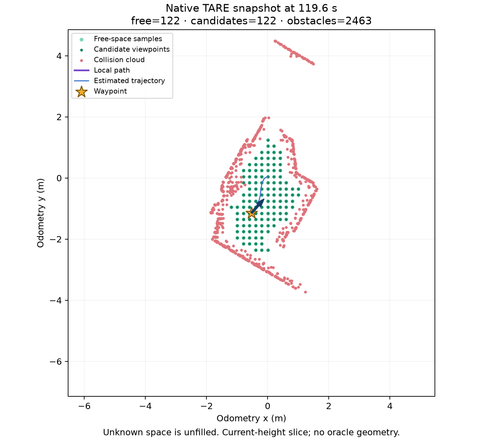
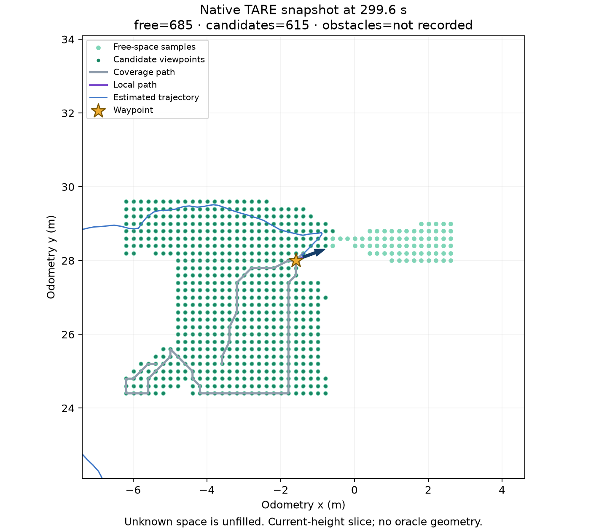

# 跨房间测试、MP3D Isaac 迁移与 TARE 可视化

本轮分支为 `codex/mp3d-isaac-visualization`。继续使用完整原生 SysNav 仿真链、
DeepSeek `deepseek-flash`、GICP 和关节驱动的 Go2。实体硬件未启动。

## 更难的 Office 任务

固定任务 `meeting_crossroom`：从接待区出发，进入另一间有会议桌和多把椅子的
会议室，找到其大型壁挂显示屏并在室内靠近、停稳。接待区的电视不能满足任务。
初始位置为世界坐标 `[-11, 29.5, 0.4]`，初始朝向 0；策略使用相对里程计原点，
并不知道目标坐标。预算为 300 秒仿真时间、最多 600 次 API 请求。

实际运行 `ui-20260928-022005-2b2f3`：299.915 秒仿真、1620.808 秒墙钟时间，
行走 68.068 米，发现 6 个空间、76 个三维物体，153 次 DeepSeek 调用全部成功。
**结果为超时失败**，未触发原生目标到达 STOP。接触审计通过；GICP 平移误差
RMSE 为 0.00591 米。这里是理想仿真传感器结果，不是实际 LiDAR 精度。

已观察到的有效行为是：23 次目标空间关系查询均没有误接受不合格显示屏，
包括接待区电视；模型确实利用了“另一间会议室”的约束。主要失败表现是长时间
覆盖西侧开放办公区，直到 208.6 秒才出现首次房间选择；随后 6 次选择均指向
同一个被标成 computer lab 的候选房间（可见电视、桌子、椅子），
末段停滞且没有转向目标会议区。94/153 次调用用于房间类型分类，也暴露了重复查询成本。

既有私有几何审查 `data/readiness/office-geometry-r2/report.json` 确认三处会议区域
有静态圆形包络路线（约 11.1–15.0 米），所以不能把本轮失败简单归因于全部门关闭。
该审查不等于 Go2 姿态全过程可通过，也没有给导航策略提供路线。
后续应优先检查门洞候选的三维关联、对未访问连接的优先级、房间选择后的执行推进，
以及停滞后的重规划；保持本轮作为完整原生 SysNav 基线，再逐项做消融。

源码提供了具体排查入口：`sensor_coverage_planner_ground.cpp` 中普通房间切换主要
由 `IsRoomFinished()` 和局部覆盖完成条件触发；VLM 的 `process_room_navigation_query`
遇到空候选直接返回。几何覆盖完成、发现可穿越门洞、存在下一房间候选是三件不同的事。
当前链路缺少“房间已覆盖但连接仍未发现”的恢复路径，不能靠让 VLM 猜一个坐标解决。

结果摘要：[JSON](results/sysnav-crossroom.json)、[失败统计](results/sysnav-crossroom-failure.json)。
三个目标房间的轨迹采样计数均为 0。轨迹与目标区域的关系如下：



评测版本 `sysnav-office-object-v2` 在运行前固定三个会议室显示屏的资产包围盒
及对应房间区域。成功同时要求：机器人在该显示屏所属房间内；离物体水平边界
不超过 2 米；策略预测的三维物体位置距包围盒不超过 0.4 米；目标有真实首命中
视线；楼面高度正确；三维速度低于 0.06 m/s 并持续至少 1 秒。接触审计另行报告。
通过墙壁接近屏幕、停在接待电视旁、只进入会议室都不能通过验收。

房间区域、物体实例、扫描模型和目标真值只由评测进程持有。导航沙箱只接收
语言指令、RGB 全景、虚拟 LiDAR 与 GICP 位姿；没有固定导航路线。

## MP3D 迁移中实际需要的适配

首个场景为 `x8F5xyUWy9e`，使用已获授权的数据。迁移保持原始三角网格与纹理，
但扫描中的门和家具仍是静态几何，不会自动变成可交互物体。

1. 原始 GLB 顶点为 Z-up，Habitat 的数据集加载器使用不同的轴变换。
   Isaac 保持原始顶点，任务位置用 `[x,y,z] → [x,-z,y]`，朝向从 Habitat 的
   本地 `-Z` 前向转换为 Go2 的 `+X` 前向。转换后的包围盒与原始坐标逐项一致。
2. 本场景的纹理采用 `GOOGLE_texture_basis`。直接使用 USD 转换器会得到白模。
   先用固定版本 Basis Universal 解码为 PNG，并恢复源文件标注的 Y-flip，
   再通过 NVIDIA Asset Converter 转换。几何二进制内容不变，纹理哈希单独记录。
3. 对 33 个网格、约 8.2 万三角形添加静态三角网格碰撞；不额外放置支撑地板。
   保留 27 个纹理材质。烘焙纹理连接到 emission，以免重复添加扫描中的光照。
4. 使用原始 Episode 7 的语言、起点及起始朝向。机器人、传感器、渲染、连续动作
   与 Habitat 官方协议不同，因此结果称为 **R2R-CE 在 Isaac 上的迁移测试**。
   完整 SysNav 原本主要解决目标物体导航；路线指令中的顺序与终点描述是额外挑战。
5. 仿真结束后，单独的 Habitat 评测进程加载官方 navmesh 计算测地距离与指标。
   导航进程不能读取 navmesh、终点或参考路径。轨迹投影要求水平偏差 ≤0.35 米、
   垂直偏差 ≤0.65 米，任何无效投影都会使整段正式计分失效，避免跨墙/跨层吸附。

首轮物理检查只检查地面、机身高度和粗略姿态，范围不足。Episode 7 的正式诊断
`ui-20260928-024754-0a472` 在 40.915 秒时主动停止：Go2 从首个物理步起就有后腿
与扫描网格的非足部碰撞，TARE 没有产生可用候选视点，只有初始化 waypoint。
导航指令中的“吧台角落”也被原生 ObjectNav 解析器映射为 `unknown`。
该轮不计入导航成绩，其测地距离仅用于诊断；详见 [诊断记录](results/mp3d-episode7-diagnostic.json)。

修订后的 `go2-mp3d-spawn-v2` 检查要求 5 秒零速度控制期间存在足部支撑、无非足部
真实接触、最终倾斜不超过 10°、水平漂移小于 0.2 米，并核对场景与控制器哈希。
前端启动的 MP3D 任务会先执行该检查，失败则报告“起点不适配”。这不会改变
原始起点、给策略添加真值，或把地面网格补成假地板。

独立评测器按官方 navmesh 的起点净空筛选第二个原始任务 Episode 1051（净空约
0.782 米），未依据终点或执行结果挑选。其起点保持原值，5 秒预检通过：水平漂移
0.0625 米，无非足部真实接触；[预检记录](results/mp3d-episode1051-spawn.json)。
这只确认初始站立可行，不保证沿完整路线可通过或任务成功。



Episode 1051 的首次正式启动 `ui-20260928-025948-31c8c` 因首帧相机尚未就绪退出，
没有产生导航轨迹。已将固定等待 4 次渲染改为最多 40 次的有界就绪检查：不推进
物理时间、不补造图像，仍失败时明确退出。原失败记录保留。

本场景还有明确的任务接口差距：原生 SysNav 的检测/指令解析使用固定物体词表，
“泳池”及“吧台角落”会落入 `unknown`。正式 VLN 适配应保留有序路线约束和空间
终点，并用在线观测验证进度；只把原句压成一个物体类别会丢失任务语义。
这与纹理、碰撞和坐标转换是独立的问题。

修复后正式运行 `ui-20260928-030137-a781c` 完整执行了 119.915 秒仿真（墙钟
970.152 秒），行走 1.919 米。结果为 **超时失败**，接触审计通过。
独立评测确认全部轨迹投影有效：终点测地误差 11.633 米，SR=0、OSR=0、SPL=0；
起始测地距离为 10.437 米，机器人没有取得有效的目标方向进展。
[运行摘要](results/mp3d-episode1051-run.json)、[迁移计分](results/mp3d-episode1051-score.json)。

机器人短暂探索后停在起始房间内。房间图只发现一个约 12 平方米的区域，邻居为空；
两次房间选择请求的 `rooms` 都为空，VLM 节点直接返回，TARE 随后持续输出
“Room finished, waiting for next action”。此时仍有局部可通行采样和 waypoint，
因此本轮并非 Episode 7 的“没有候选视点”问题。它揭示的是房间覆盖结束后没有
可用空间连接时的恢复缺失。



这里的 nDTW 使用所有 10 Hz 投影轨迹采样，长时间停滞中的微小物理位移也会进入
对齐，不能与其他采样/动作协议下的数值混比。该实验只有一个场景中的一次有效
迁移测试，尚不是完整 MP3D 基准评测。

## TARE / waypoint 可视化

前端读取原生 ROS 消息，约每 0.5 秒归档一帧。时间轴只选当前时刻之前的帧，
超过 3 秒的图层不显示。vehicle 坐标的局部路径按消息时间匹配位姿后转换至 map，
不使用评测器世界真值对齐。

| 图层 | 原生来源 | 含义 |
|---|---|---|
| 浅绿可通行采样 | `/freespace_cloud` | 无碰撞、视线可达且连接的视点采样；20 秒后才开始发布 |
| 深绿候选视点 | `/viewpoint_vis_cloud` | 当前满足原生选择条件的候选 |
| 红色障碍 | `/collision_cloud` | TARE 实际用于候选碰撞检查的合并点云 |
| 青色候选路径 | `/free_paths` | localPlanner 的无碰撞路径采样 |
| 紫色局部路径 | `/path` | localPlanner 当前选择的路径 |
| 灰色探索路径 | `/local_path` | TARE 局部覆盖路径 |
| 黄色星标及历史点 | `/way_point` | 当前与历史 waypoint |
| 蓝色轨迹 | 在线里程计 | 策略实际使用的相对轨迹 |

绿色表示规划器当前观测下的可行采样，不是全场景通行保证；未知区域保持空白。
点云按当前机器人高度邻域显示。第一轮 Office 记录发现 `/terrain_collision_cloud`
并不实际发布，因此该轮没有红色障碍层；后续运行已改为 `/collision_cloud`。
不能为旧记录补造障碍数据。



此图是独立导出的原生消息快照。没有记录到的图层明确标为 `not recorded`，
前端对应显示“无数据”，与收到一帧空点云区分。可通过
`python scripts/summarize_planning.py <运行目录> --time 299` 导出指定时刻。

第三人称相机只供回看，通过环境射线缩短或旋转观察臂，减少进入墙体的问题；
相机控制不会反馈给导航策略。界面展示结构化决策、观测依据及简短理由。

## 复现入口

所有远端路径均在 `~/VLN`；使用项目局部 GPU 动态库，无需重启或更改系统驱动。

```bash
cd ~/VLN/cross-building-floor-nav
# 新环境的 Basis 解码器安装可放在后台；固定版本与编译不覆盖系统目录。
nohup bash scripts/install_basisu.sh > ../logs/basisu-build.log 2>&1 &

# 解码纹理并转换场景，然后执行物理/视觉检查。
OMNI_KIT_ACCEPT_EULA=YES bash scripts/with_gpu_compat.sh \
  ../envs/isaac51/bin/python -u sim/build_mp3d_isaac.py
OMNI_KIT_ACCEPT_EULA=YES bash scripts/with_gpu_compat.sh \
  ../envs/isaac51/bin/python -u sim/check_mp3d_isaac.py --episode-id 1051

# 与前端使用相同的单任务启动和独立计分流程。
OMNI_KIT_ACCEPT_EULA=YES bash scripts/with_gpu_compat.sh python3 \
  scripts/benchmarks/run_isaac_mp3d.py --name mp3d-episode1051 --episode-id 1051 --max-seconds 120
```

每轮记录位于 `data/sim/office/runs/<运行名>`。其中 `agent/planning` 是原生规划回放；
`agent/api.jsonl` 是 API 结构化结果；`source` 保存本轮代码快照与验收定义。
`benchmark_result.json` 仅在 MP3D 后评测结束后生成。其他数据下载保持后台运行。

## 工程验证范围

在 5090 的 `envs/sysnav-full` 环境执行 `PYTHONPATH=src python -m unittest discover -s tests -q`：
101 项测试，95 项通过、6 项按环境条件跳过。新增验证覆盖坐标/朝向转换、带时间的
规划回放、跨房间验收，以及相机延迟就绪和有界失败。前端 JavaScript 语法检查通过。
运行图像、物理接触、VLM 请求和独立评测是另外记录的仿真证据；单元测试通过并不
代表导航成功。实体机器狗未启动，也未获得实机闭环结果。

参考：[NVIDIA Asset Converter](https://docs.omniverse.nvidia.com/extensions/latest/ext_asset-converter.html)、
[Matterport3D 官方项目](https://github.com/niessner/Matterport)、
[Basis Universal 官方工具](https://github.com/BinomialLLC/basis_universal/wiki/basisu.exe-Command-Line-Tool-Options)。
