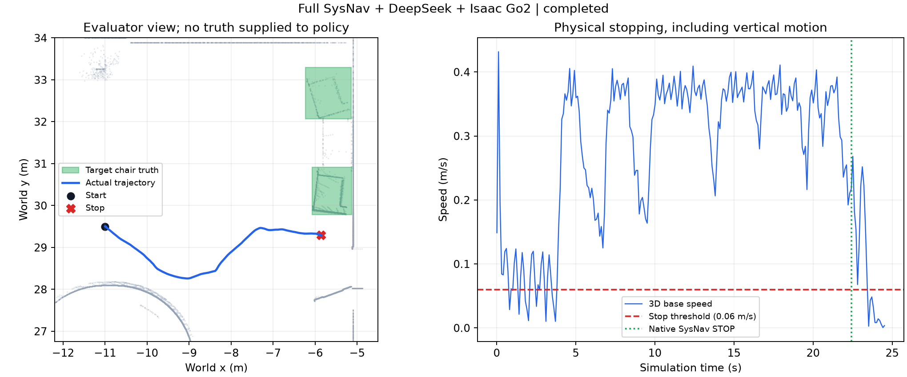

# 完整 SysNav 单场景仿真验收

2026-09-28 在 5090 的 NVIDIA Office 场景中，完整 SysNav 仿真导航链、
DeepSeek Flash 和 Isaac PhysX Go2 完成了一次自主物体导航验收。
最终运行：`ui-20260928-015936-be867`。这是工程单案例验收，不是统计成功率。

任务指令：
> Find a black chair with a padded seat, padded backrest and armrests in the reception area. Stop close to the chair.

策略只有在线 RGB 全景、LiDAR、GICP 相对里程计与语言指令。目标坐标、场景资产、
独立验收标注不挂载到策略进程。没有预写路径、人工中途 waypoint 或遥控输入。

## 结果

| 项目 | 实测结果 |
|---|---|
| 任务 / 综合验收 | completed / acceptance_passed=true |
| 仿真时间 | 24.515 s |
| 运行循环墙钟时间 | 147.471 s，不含 Isaac 启动与资产加载 |
| 实际行驶距离 | 6.148 m |
| 到目标椅子水平边界距离 | 0.492 m，阈值 1.0 m |
| 预测三维目标位置 | 落在指定椅子的世界包围盒内 |
| 目标视线 | 首个碰撞命中为目标椅子，可见性通过 |
| 停稳 | 三维底座速度 <0.06 m/s 持续 1.1 s |
| 接触审计 | 通过；未记录非足部真实物理接触 |
| 在线地图末态 | 2 个房间、4 个三维物体 |
| DeepSeek 调用 | 79 次全部成功，78 次携带图像 |
| API 延迟 | 中位数 0.887 s，P95 1.294 s |
| Token 使用 | 输入 50,354，输出 3,015，共 53,369 |
| 实机状态 | 未验证，physical_hardware_ready=false |

左图为评测器视角，绿色是真值椅子边界；右图为包含竖直运动的三维底座速度。
原生 STOP 后切换仿真关节站立控制，速度降至阈值以下。不存在位姿重置或刚体锁定。

完整机器可读结果见 [summary JSON](results/sysnav-full-single-scene.json)。
远端原始证据位于
`~/VLN/cross-building-floor-nav/data/sim/office/runs/ui-20260928-015936-be867/`：
`report.json`、`trajectory.jsonl`、`contacts.jsonl`、`agent/api.jsonl`、
`agent/events.jsonl`、每个原生节点日志，以及 RGB 全景/第三人称图像。

## 原生模块的执行证据

本次运行收到 23 帧检测结果、22 次房间图更新、36 次物体图更新、
37 次物体类别回答、25 次目标验证回答；原生 TARE 产生 23 个 waypoint，
localPlanner 产生 113 条路径，pathFollower 产生 5,971 条速度消息。
指令分解、房间分类、目标属性验证、三维关联与原生接近/停止已在闭环中执行。

最终通过运行中房间导航查询候选为空，没有触发房间选择 API；
此前同场景 `ui-20260928-014610-2e945` 已返回 12 次房间选择回答。
不能用本次成功推断空间关系、参照物、全部八类查询或多房间长距离任务均已验证。

编译：8 个选定 ROS 包成功。接口检查：7 项前端测试、5 项独立评测测试通过；
全景投影独立射线检查覆盖 175 个点，最大单位射线误差 0.00639。
这些是编译/纯测试证据，与本次真实 Isaac 动力学闭环分开报告。

## 失败记录与修改边界

| 运行 | 结果与处理 |
|---|---|
| 013836-90485 | 2.015 s 出错：十个 ROS 进程超出 localhost DDS participant 默认范围；采用进程局部配置修复。 |
| 014037-27443 | 5.015 s 出错：NumPy ID 与 ROS 整数消息不兼容；同时修复语言类别 armchair 与检测类别 chair 的词表不一致。 |
| 014232-f6235 | 21.015 s 人工停止调试：任务误写 student lounge，实际为 reception，VLM 正确拒绝；修改任务描述后重新测试。 |
| 014610-2e945 | 29.415 s 原生已到椅旁，旧公共区域检查判为错误停止；保留失败，不回填新评分。 |
| 015458-2c811 | 新物体验收规则下，原生 STOP 后零速步态仍踏步，43.015 s 停止调试；增加平滑站立模式。 |
| 015936-be867 | 相同物体任务、起点和物体验收阈值，完成自主到达与停稳。 |

以上运行均使用日期前缀 `ui-20260928-`。任务和评分在开发中有明确变更，
不应将六次调试当作同一协议下的成功率，也不将第 4 次结果重新标为成功。

最终物体评分 `sysnav-office-object-v1` 在第 5 次启动前固定，第 6 次只增加
底层物理站立控制。旧区域字段 `independent_goal_region=false` 继续保留，
它对应另一项“进入公共区域”的任务，不是当前椅子接近任务的成功条件。

## 迁移状态与剩余问题

平台分支为 `codex/sysnav-full-port`；官方 SysNav 基线为 `478727e5`，
移植依赖提交 `8496d75ba92b200979b2cfb445155c1cfd417420`。
[迁移说明](sysnav-full-port.md) 列出模块来源、源码补丁、部署命令和传感器外参。
生产 `TARE_WheelTECH` 配置保持未改动，所有新增组件位于 `~/VLN`。

重复语义查询较多，chair/sofa 和部分房间类型仍会随视角变化；需要做查询去重、
时序一致性和多起点测试。GICP 在无噪声静态虚拟 LiDAR 下的 0.292 mm RMSE
仅说明当前仿真接口一致，不能外推为真实定位精度。实体 Go2、ARISE/Livox、
噪声与延迟、多楼层及标准 MP3D/VLN 基准均未由本次验收覆盖。

前端 `http://127.0.0.1:8878/` 选择「SysNav · 寻找接待区扶手椅」和最终运行，
可以播放机器狗、全景 RGB、轨迹与简短决策依据。
