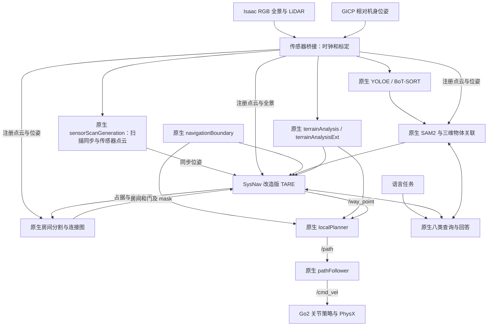
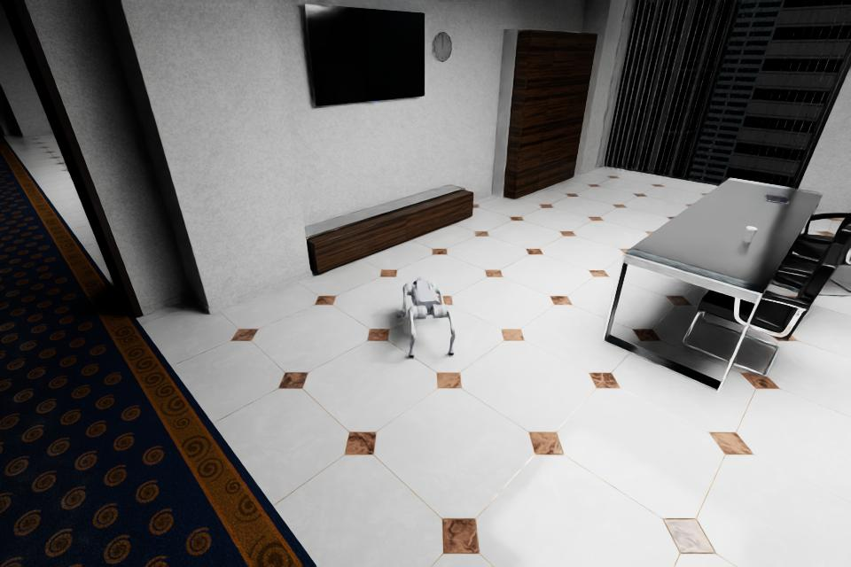

# SysNav 系统对齐与 Isaac 失败审查

本轮平台分支 `codex/sysnav-system-parity`；依赖分支 `codex/isaac-system-parity`。
比较对象是实际固定的官方 **SysNav `unitree_go2` 分支**提交
`478727e5a559be22822d5d093b57431449336287`，而不是另一个同名 NavSys 项目。
本文比较源码、启动图、有效参数、传感器契约和实际执行链；模型提供商不是判据。

**此前“完整原生 SysNav 基线”的表述过强。** 原生核心模块已经接入，但启动节点、
有效参数和传感器位姿仍存在迁移差异，不能据此把先前跨房间失败直接归因于原算法。
本轮先修复这些差异，再重跑冻结的跨房间任务。保留旧运行和旧配置，不修改旧成绩。

## 1. 实际系统架构与 TARE 来源



这里使用的是 **SysNav 自带的 TARE 扩展**，不仅是原版几何覆盖 TARE：它包含房间
分割、房间与物体表示、语义查询、房间选择、提前结束探索、目标接近与停止。
本轮没有另写房间策略，也没有用自定义 Mission Bridge 替换原生选点和速度链。
新传感器桥只负责输入、监督和记录；旧任务桥的继承关系已移除。

固定上游中，`room_segmentation`、`representation`、`keypose_graph`、`planning_env`、
`rolling_occupancy_grid`、`tsp_solver` 六个源码目录与当前版本逐字节一致。
`localPlanner`、`pathFollower`、terrain 两个节点以及 sensorScanGeneration 也没有源码改写。
这不等于所有 TARE 文件相同：其余兼容、标定和越界修复逐文件列在
[源码审查锁](../config/sysnav-source-review.json)，目前共有 17 个改动文件。

## 2. 找到并补齐的系统差异

| 项目 | 迁移前 | 本轮处理 | 可能造成的影响 |
|---|---|---|---|
| 扫描同步 | 桥直接兼任同步位姿发布，未启动原生 sensorScanGeneration | 启动原生节点，由它发布 `/state_estimation_at_scan` 与 `/sensor_scan` | 同步链、坐标转换责任与上游不同 |
| 导航边界 | 没有原生 navigationBoundary，覆盖边界开关关闭 | 启动原生节点，使用公开的 ±140 m 工作范围，恢复开关 | 候选与 frontier 的过滤行为不同 |
| LiDAR 位姿 | 实际射线从 base 上方 0.45 m 发出，TARE 却收到 base 位姿 | 将 GICP base 位姿刚体转换到真实射线起点；已注册世界点不平移 | TARE 自由空间射线起点、传感器视域和地形相对高度错误 |
| 相机/TF | 三处投影以 base 为参考；vehicle 当作完整机身姿态 | 相机与 LiDAR 共原点；base_link 单独定义；vehicle 按 native localPlanner 的 yaw-only 坐标定义 | 只改 LiDAR 高度会再次破坏融合；原路径显示会随 roll/pitch 错倾斜 |
| TARE 参数 | 局部手写参数与官方 launch 合成结果不同 | 从固定上游 Git 直接生成，保留有理由的载具适配白名单 | 视点、覆盖、全局图、房间分割和执行行为均可改变 |
| 初始 waypoint | 初始前探距离被改为 0 | 恢复原生 12 m 初始前探目标，由局部避障执行 | 可能减少启动阶段的主动观察与探索 |
| 语言任务字段 | 上轮迁移把目标/参照物约束成 detector 词表 Literal | 恢复上游自由字符串 schema，并补共享 detector 标识和大小写/分隔符归一化 | 不能把旧版对 pool/bar 的 unknown 直接归因于上游解析器 |
| 房间记录 | 回放端只追加房间，不删除原生已删除的 ID | 按完整 RoomNodeList 快照替换 | 旧“发现 6 房间”包含历史 ID，不能当作同时存在的房间图 |
| 诊断证据 | 缺 room mask/door、实际参数及已加载库记录 | 新增原生 mask、door/room cloud、进程和参数快照 | 避免只根据画面或模型回答定位失败 |

原生 `room_segmentation` 还声明了 `/navigation_boundary` publisher，但源码没有任何
对应 publish 调用。运行审计保留这个上游行为：真正发送边界的是 navigationBoundary。
不能把仅声明但不发布误判成两个互相覆盖的边界源。

### 参数差异并非模型差异

与上轮配置比较，46 个已有参数条目发生变化（含删除无效参数）；完整列表见
[参数变化](results/sysnav-parameter-differences.json)。有代表性的恢复如下：

| 参数 | 上轮 | 固定上游仿真配置 |
|---|---:|---:|
| TARE `kSensorRange` | 10 m | 3 m |
| `kLookAheadDistance` | 1 m | 4 m |
| `kExtendWayPoint` / `kRushHome` | false / false | true / true |
| 点云网格尺寸 | 20×20×5 | 50×50×30 |
| 全局栅格尺寸 | 51×51×5 | 121×121×121 |
| 房间 mask | 1200×1200 | 3000×3000 |
| terrain `decayTime` | 30 s | 1 s |
| terrain `minBlockPointNum` | 3 | 10 |
| pathFollower `twoWayDrive` | true | false |
| detector 阈值 | 0.30 | 0.35 |

注意 `kSensorRange` 是 TARE 的算法参数；虚拟 LiDAR 的最大射线长度仍为 10 m，
两者不是同一个量。`terrainAnalysis.vehicleHeight=1.5` 是原生算法参数，并非
把机器狗的实体高度设置成 1.5 m。实际载具与传感器高度记录在单独的适配清单中。

[生成器](../scripts/build_sysnav_parity_config.py) 按上游 XML/YAML 合并顺序读取，
避免只看 YAML 而忽略 launch 再次覆盖。20 项显式例外在
[Isaac 适配清单](../config/sysnav-isaac-overrides.json)：自主启动、Go2 尺寸/速度、
相机模型、地面种子高度及输出目录等。其余参数继承固定官方仿真启动配置。
所有节点使用同一个 Isaac 时钟。

运行时额外核对参数服务：上游 YAML 中若干字段根本没有被节点声明，
例如 `goalReachedThreshold`、`goalYawGain` 和若干 door 参数。报告明确列为
**未生效的上游字段**，不把“文件中存在”当作生效；新增未声明算法参数会使审计失败。

## 3. 保留的有意差异及结论边界

- Isaac PhysX + 关节驱动 Go2 替代上游 Unity/运动学仿真和实际 WebRTC 载具接口。
  低速控制范围、关节站稳技能是当前机器人适配，不是 SysNav 原生运动能力。
  已核对上游 `unitree_control.py`：默认 `wireless_controller` 把 ROS 分量映射为
  摇杆通道，另有 `sport_cmd/Move` 模式；本平台直接将 m/s、rad/s 输入仿真步态策略。
  未提供真实固件/摇杆响应标定，二者的执行动态不能声称相同。上游节点还显式退出
  内置避障，不能臆测真实 Go2 会替上层自动纠正所有碰撞。
- GICP 替代实机 ARISE/Livox 链。本轮扫描 5 Hz、全景 1 Hz，瞬时理想扫描、无 IMU
  融合；原版 Unity 传感器资产没有随固定仓库提供，不能声称传感器分布与速率已复刻。
  上游还有 wall timer 与 ROS timer 混用；Isaac 按观测步推进，实际调度不等于实机实时。
- YOLOE-26x 使用可部署的 `.pt` 权重和相同原始词表，替代未提供的机器专属
  TensorRT engine；SAM2 权重有哈希记录。没有原 engine，不能声称数值逐位等价。
- 保留缩短采样队列的越界修复、空 mask 守卫、ROS 物体批量消息/bool/int 契约修复、
  当前库的 BGR/RGB 输入修复、Humble 头文件兼容。采样越界修复会改变未定义行为，
  应在上游对照也应用同一修复；绝不为“源码一样”恢复崩溃。
- 相机外参、公开工作边界、模型路径、只读状态和决策摘要是有记录的替换。
  API 后端按用户要求保持 DeepSeek；本文不以提供商差异代替系统审查。

因此可验证的表述是：**没有未记录的源码/配置漂移，核心规划与语义流程已对齐，
运行链满足当前明确的仿真接口契约**。不能科学地保证“任何层面都零差异”。
剩余失败仍须先检查感知、同步/队列和载具适配，不能看到 gate 通过就宣布算法有错。
原生采样使用 `std::random_device`，API 回答也可能变化；本轮一次成组系统修复不是
单变量消融，轨迹或首次查询时间的变化不能单独归因于某一项修复。

## 4. 独立判断目标是否可达

对同一 Office 场景、同一起点 `[-11,29.5,0.4]` 和同一 Go2 checkpoint，先在
评测器中检查完整碰撞几何，再用该机器人真实关节力矩执行评测器路线。
这是 **oracle 可达性控制实验**，没有启动 SysNav，路线和真值没有进入策略沙箱。

有效记录为 `crossroom-reachability-r3`：三个会议室屏幕都有带目标可见性条件的
可达停止区域；圆形中心净空至少 0.45 m。选中的屏幕为 `SM_TV_for_wall5`，
规划路线 13.654 m，实际行走 13.363 m，用时 46.915 仿真秒；58 个路线地面采样
均有真实支撑。Go2 到达正确会议区域、距屏幕边界 1.814 m、目标可见、停稳 1.1 s，
未出现非足部真实接触。最大倾斜约 6.75°。

这排除了“这个任务的全部合格目标在此场景都不可达”，不能证明所有路线或姿态都可行，
也不是视觉识别/自主探索成功。目标三维点由 oracle 提供，所以该实验的 grounding
误差 0 是控制条件，不能当作视觉定位指标。

[完整可达性证据](results/sysnav-crossroom-reachability.json)



## 5. 本轮验证与重跑

- 编译：9 个 ROS 包完成；11 个原生运行节点及传感器桥启动。
- 纯测试：112 项，106 通过、6 项按环境跳过；不计为导航成功。
- 实际 mapper 投影与 Isaac 全景方向一致；独立全景测试 175 个方向点通过。
- 真实 native 采样函数：10,000 次 ASan 小队列测试通过。
- 源码审查、配置继承和 smoke-003 的运行参数/发布者/加载库检查最初通过；
  正式诊断进一步发现类别契约缺口，已增加跨模块标识检查。旧 gate 结果不等于完整功能通过。见
  [机器可读审计](results/sysnav-source-parity.json)。20 秒 smoke 只检验运行接口。
- 跨房间正式重跑及其结果在下文单列，不与 oracle 控制实验混算。

### 诊断轮 001：发现新的功能契约缺口，主动中止

`sysnav-parity-crossroom-001` 没有计为最终算法评测。恢复自由字符串 schema 后，
实际指令 target 为 `tv monitor`，检测和三维节点却为 `tv_monitor`。原生下游精确
比较字符串，因此虽已有多次屏幕检测，目标核验查询仍为零。这个接口问题在节点
启动和参数检查中发现不了。本轮新增共享词表提示、纯字符串格式归一化，以及
运行前的目标/参照物标识检查；保留自由字符串，不把 unsupported 的 pool 等偷换为 unknown。

该轮约 31.57 秒还发生后腿与 ReceptionStand 家具的真实接触（最大冲量约 0.73 N·s）。
上游仿真默认 `checkRotObstacle=false` 不适合直接作为关节 Go2 的验收配置。
发生接触时静态中心净空约 0.40 m，小于配置包络的转向半径 0.461 m。
现显式开启原生已有的转向包络检查，并保留几何和接触审计；这不是修改 TARE 的选点算法。

75.3 秒产生了非空房间候选，75.7 秒获得 room 2 的普通选择回答，但原生回调只缓存
该回答，机器人仍覆盖房间 1。这是后续策略审查的证据，**不能用有类别契约缺陷且
中途停止的一轮来证明算法优劣**。001 的输入、源码和运行记录全部保留。

### 对齐轮 002：确认上游提前切换分支被硬关闭

`sysnav-parity-crossroom-002` 已通过启动图、实际参数、加载库和类别契约检查，
目标为正确的 `tv_monitor`，物体类别核验分支也实际执行。约 13.2、14.2 秒，
API 两次返回 `early_stop=true`，但没有对应的 `answer_type=1` 房间切换消息。

核对固定上游提交和当前代码，`process_room_early_stop_1_query()` 均为：

```python
early_stop = answer.early_stop
if False:  # pinned unitree_go2 release
    # publish VlmAnswer(answer_type=1)
```

这不是迁移过程中删掉了 TARE，也不能据此认定 VLM 没有作出正确选择；
**固定 Go2 上游的功能分支本身被关闭，真实回答没有进入执行链。**
普通房间选择 `answer_type=0` 又只缓存候选，等覆盖完成才执行，因此大开放区域
会拖延转移。002 在找到这个证据后主动停止，保留为功能诊断，不统计整任务成绩。

为避免混淆原始复刻和修复，新增参数 `enable_room_early_stop`，默认 false 完全
保留固定上游行为；只有显式 `--enable-room-early-stop` 才启用原来已有的发布分支。
C++ TARE、目标打分、路径算法和任务条件均不改。测试直接执行原/新源码中的
实际回调，在固定 API 回答下验证：上游丢弃 true；启用后发布房间 2 的 type 1；
关闭时保持原行为；false 决策及误入房间恢复保持正确。

启用后的运行须作为“修复上游关闭功能”的单独实验，而不是冒充未修改的官方基线。

## 6. 重跑后的分层判据

保持任务、起点、checkpoint、场景、传感器模式、API 上限及验收定义一致。
先检查节点是否掉线、扫描同步、坐标/投影、旧库、有效参数、里程计误差与接触；
再检查房间 mask/门连接是否正确、目标是否进入检测和三维地图；最后分析原生
候选筛选、房间选择、局部 waypoint 和跟踪执行。每一级都要有时间对应的证据。

如果已知门洞前的有效候选一直被房间条件过滤，才研究未知连接探索机制；
如果进入房间后目标被正确检测而原生状态未推进，才研究语义/状态机问题；
如果 waypoint 正确但局部路径/动作无进展，才分析局部几何规划或执行。
不会直接添加 GT waypoint，也不会先改目标区域来让测试通过。

复现入口：

```bash
cd ~/VLN/cross-building-floor-nav
../envs/sysnav-full/bin/python scripts/build_sysnav_parity_config.py --check
../envs/sysnav-full/bin/python scripts/audit_sysnav_parity.py \
  --run data/sim/office/runs/sysnav-parity-smoke-003
```

每轮保存 `source/` 文件哈希、Git revision、native 二进制证据，以及
`agent/runtime-contract.json`、`agent/planning`、各节点日志、API 显式回答和简短依据。
策略仍通过 bwrap 与场景/目标真值隔离。实体设备、生产 TARE_WheelTECH 和下载任务均未改动。
